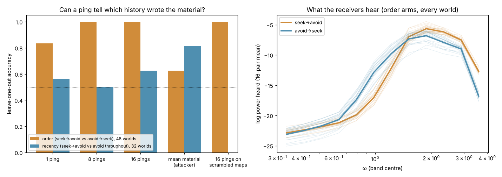
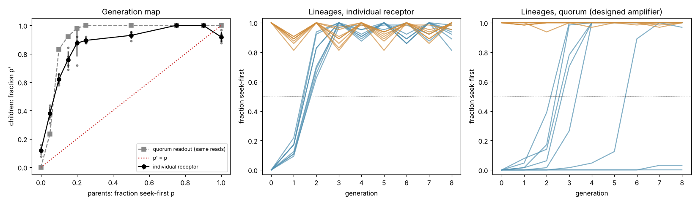

# Evening — a ping reads what scouts wrote

**A wave pulse sent through scout-written material can tell which of two histories
wrote it, without ever seeing the map.** For the order test (seek-then-avoid vs.
avoid-then-seek, equal totals), 16 pings separate 48 fresh worlds perfectly (LOO 1.000,
p < 0.0005), 8 pings also perfectly, and one ping at 0.83. Mean material reaches only
0.63. For the harder recency test the reader **fails** (0.63, p = 0.18). On 32 fresh
worlds, that history turns out to be partly a difference in *amount*, which corrects
Aug 31.

**Part 2 (a reader that writes back):** when children's schedules are set only by
pinging their parents' material, no heredity appears. The seek-first state is
**dominant**: 5% seek-first parents become 38% seek-first children, so every lineage
converges to it. Avoid-first is recessive and unstable (0 of 8 lineages keep it; a
designed quorum vote keeps 2 of 8). Pre-registered, prediction held.

Live page: **[anttiluode.github.io/Evening](https://anttiluode.github.io/Evening/)**.
Choose a history, watch the scouts write it, then freeze the material and read it with
16 pings. The page shows what the receivers heard and which history they name.



## Why this repo

Two lines each had the half the other lacked:

| | writes the medium | reads the medium |
|---|---|---|
| train.html → Cell 0 → Datarium ([BlackBoxLab](https://github.com/anttiluode/BlackBoxLab)) | scouts lay material under a conserved budget | only a god's-eye look at the whole map; Aug 31 named the next gate as "it needs a READER" |
| Kavitaatio → [WallMemoryLaw](https://github.com/anttiluode/WallMemoryLaw) | walls written by fiat | one ping, a listening window, a footprint known from geometry |

Evening uses the Cell 0 scouts as the writer and a ping as the reader.

## What was built

- **Writer:** `writer/cell0.py` and `writer/signature.py`, copied unchanged from
  BlackBoxLab (Aug 31), same configuration. Scouts read a Klein–Gordon field, eat a
  conserved resource and lay material M that raises the local mass term V = 8M. The two
  arms of each test differ only in when the scouts climb the field envelope (seek) and
  when they descend it (avoid).
- **Reader** (`reader.py`): the scouts are removed, M is frozen, and Cell 0's own
  field becomes the probe. A sharp Gaussian ping (σ = 0.5) is released at a source and
  heard at a receiver 20 cells away, for a 150-step window. There are 16 such pairs on a
  grid. Features: log power in 12 frequency bands, averaged over the pairs.
  Classifier: leave-one-out nearest centroid, as on Aug 31.
- **Footprint** (Gate 0, the bulk form of WallMemoryLaw's tour law): a window ending at
  t₁ can only have heard material with d(src, x) + d(x, rec) ≤ c·t₁. Swapping
  everything outside that ellipse (plus 4 cells) for another world's material changes
  the trace by at most 1.2e-8 of its peak, or 4e-12 with an 8-cell margin. Swapping the
  inside changes it by 240%.

## Pre-registered result

[PREREG.md](PREREG.md) was pushed as `1fa7b2b` before any confirmatory world existed.
Order: 24 worlds per arm; recency: 16 per arm; all on fresh seeds.

| | prediction | result | |
|---|---|---|---|
| P1 | order, 16 pings: LOO ≥ 0.90, p < 0.01 | **1.000**, p = 0.0005 (the floor of 2000 shuffles) | pass |
| P2 | mean material ≤ 0.70, and ping beats it by ≥ 0.20 | mean 0.625; margin 0.375 | pass |
| P3 | order, 8 pings ≥ 0.85 | **1.000** (1 ping: 0.833) | pass |
| P4 | recency, 16 pings ≥ 0.75, p < 0.05, mean material ≤ 0.70 | ping **0.625**, p = 0.18; mean material **0.812** | **fail** |
| P5 | order, 16 pings on phase-scrambled maps ≥ 0.85 | **1.000** | pass |
| R1 | god's-eye: quantiles alone ≥ radial spectrum shape alone | 1.000 vs 0.958 | pass |
| kill | ping ≤ best scalar + 0.10 on order | did not fire | |

"Mean inside the union of the 16 footprints" was meant as a second scalar attacker. The
footprints together cover the whole world, so it equals the global mean. Noticed in a
smoke test on development data, after PREREG was frozen.

## What the reader actually reads

**The distribution of amounts, not the layout.** The ping separates the order arms
just as well when each map is phase-scrambled (same power spectrum, same values,
arrangement destroyed: 1.000). It also does when the pixels are simply shuffled (same
values only: 1.000). The two histories write different value distributions:

| percentile | 10 | 25 | 50 | 75 | 90 | 99 |
|---|---|---|---|---|---|---|
| seek → avoid | 0.125 | 0.155 | 0.194 | 0.247 | 0.388 | 0.613 |
| avoid → seek | 0.054 | 0.080 | 0.126 | 0.212 | 0.733 | 0.999 |

Avoid-first writes a thin background plus saturated walls; seek-first writes something
more even. Material raises the local cutoff frequency √(8M), so a broadband ping hears
that distribution as transmission vs. frequency. Avoid-first lets more through at
ω ≈ 0.7–1.3 and less above 2 (right panel of the figure).

## Corrections to Aug 31 (BlackBoxLab `Claude/`)

1. **"The record is in the arrangement, not the amount"** should read **"in how the
   amount is distributed"**. With equal totals, quantiles alone separate the order arms
   (1.000). The radial spectrum shape does too (0.958), so arrangement also carries
   history, but the reader doesn't need it.
2. **The recency result does not replicate.** Aug 31 had mean material at chance (0.583,
   12 worlds). On 32 fresh worlds it separates the arms at 0.812 (p = 0.0005,
   d = −1.37): seek-then-avoid leaves 0.269 ± 0.006 against 0.278 ± 0.003. That history
   is partly a level. The 16-ping reader doesn't recover it (0.625).

## The page

`evening.js` ports both the writer and the reader to JavaScript.

- **Reader:** matches `reader.py` to 5e-15 on the trace and 2e-12 on the 16-pair
  features (checked in Node on a development world).
- **Writer:** a port with its own random numbers, so it can only match statistically.
  Its material quantiles match Python's to within ~0.015 in both arms. 12 of 12
  JS-written order worlds are classified correctly by the reader trained on the 48
  Python worlds (`check_js_worlds.js`, `results/posthoc.json`).

"Free hand" lets you flip the scouts between seeking and avoiding while they write; the
reader then says which of the two trained histories the result sounds like.

## Part 2 — a reader that writes back: does the loop carry a bit across generations?

([PREREG_INHERIT.md](PREREG_INHERIT.md), pushed as `bf9c072` before the runs; code in
`inherit.py`, `inherit_run.py`, `decide_inherit.py`.)

**The loop.** One bit is heritable: seek-first or avoid-first. A population with
seek-first fraction p writes for 4000 steps, then its scouts are removed.
- **Reading:** 64 sites on an 8 × 8 grid each fire one local ping. A fixed receptor (a
  nearest-centroid table frozen from part 1's 48 pure worlds; single-pair accuracy
  0.876) turns each site's spectrum into a decision.
- **Next generation:** a fresh world with blank material, where child i takes site
  i mod 64's decision.

**No genome is copied.** The only channel between generations is material → ping →
receptor. Heredity would mean a lineage remembers its ancestors: the generation map
p′ = f(p) needs a stable state on both sides.



**Result: no heredity. One state is dominant.**

| | prediction | result | |
|---|---|---|---|
| H1 | f(0) ≤ 0.2 and f(0.5) ≥ 0.8 | f(0) = 0.117, f(0.5) = 0.930 | pass |
| H2 | individual receptor: **no** heredity | avoid-first lineages still avoid-first at gen 8: **0 / 8**; seek-first: 8 / 8 | pass |
| H3 | quorum (designed amplifier): heredity | **2 / 8** vs 8 / 8 | **fail** |

The generation map, 4 worlds per point:

| p | 0 | .05 | .10 | .15 | .20 | .25 | .50 | .75 | .90 | 1 |
|---|---|---|---|---|---|---|---|---|---|---|
| f(p), individual | 0.117 | 0.379 | 0.621 | 0.758 | 0.875 | 0.895 | 0.930 | 1.000 | 1.000 | 0.918 |

- **f(p) > p everywhere below ≈ 0.92**, so the only stable state is seek-first. The
  avoid-first state is not merely noisy, it is **unstable**. Near p = 0 the slope is
  about 5: 5% seek-first scouts become 38% in the next generation. A perfect receptor
  would not save it.
- **Quorum** makes p = 0 an exact fixed point (f_q(0) = 0.00), but still an unstable
  one (f_q(0.05) = 0.24). Lineages sit there until a spatially clustered reading error
  slips through. Survivors below 0.5, generations 0–8: 8, 8, 8, 4, 3, 3, 2, 2, 2.
  Metastable, not heritable. The individual arm loses all 8 at generation 2.

**What emerged, without being coded:** dominance. Seek-first is dominant and
avoid-first recessive. The avoid-first signature is an *absence* — a thin background
between saturated walls — and a few seekers fill the background in. Seek-first's
signature is a *presence*, and survives contamination. The lesson for any
medium-as-genome: **a heritable state has to be written as something present, not as
something missing.** Two inheritable states need two presences, for example two
material species that the ping hears at different frequencies. A seek-first fraction
written as more or less of the same material cannot be both.

The same structure appears in Eigen's error threshold: heredity needs copying fidelity
above a threshold set by how strongly the competing state amplifies. Here the
amplification (slope ≈ 5) is so strong that no fidelity is high enough for the
recessive state.

## Not claimed

- **That the reader reads arrangement.** It reads a value distribution.
- **Inheritance.** Part 2 measured its absence for this two-state code. A lineage keeps
  only the dominant state, and it would keep that one from any start.
- **Anything about the copied Cell 0 code beyond this use.** Its budget leaks 1e-4
  through `clip(M, 0, 1)` after deposition (Gate 0); left unchanged so the writer is
  exactly Aug 31's.

## Run

```
python gate0.py                  # footprint, stability, budget
python worlds.py order 24 70000  # confirmatory worlds (about 5 min)
python worlds.py recency 16 80000
python main.py order recency     # reader, attackers, surrogates
python decide.py
python make_figures.py && python make_page.py
node check_js_worlds.js          # does the JS writer match?
python inherit_run.py indiv      # part 2 lineages (about 15 min each arm)
python inherit_run.py quorum
python inherit_run.py map
python decide_inherit.py
```
